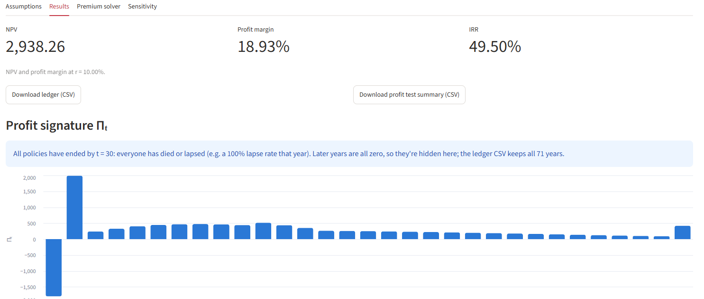
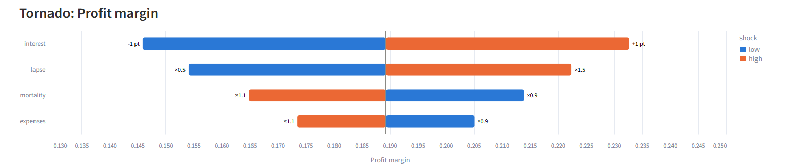
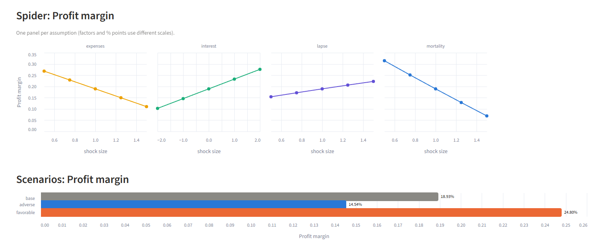
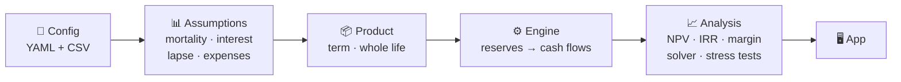

# Life Insurance Pricing & Profit-Testing Engine

**Price a life insurance policy, test its profitability and stress it, then check that every number matches the textbook to the cent.**

[](https://dhw-pricing-engine.streamlit.app)




---

## ⚡ In 5 seconds

- 🎯 **Matches the textbook to $0.01.** Every result is checked against *Actuarial Mathematics for Life Contingent Risks* (Dickson, Hardy & Waters), Ch. 13.
- 🧩 **Plug-and-play assumptions.** Swap in any mortality table, interest rate (flat or by year), lapse table or expense basis without changing code.
- 🌪️ **Built-in stress testing.** Tornado, spider and combined "bad case" scenarios in one click.
- 🖱️ **No install needed.** [Open the live app](https://dhw-pricing-engine.streamlit.app), change any input and watch the profit move.

---

## ✅ Proof it works

Each row below is an automated test. The engine must reproduce the published value or the build fails.

| What | Textbook (DHW) | This engine |
|---|---|---|
| 10-year term: net premium Pⁿ | 1,447.63 | **1,447.63** ✅ |
| Term: NPV at 10% risk discount rate | 74.13 | **74.13** ✅ |
| Term: profit margin | 0.77% | **0.77%** ✅ |
| Term: IRR | 12.4% | **12.4%** ✅ |
| Term: premium for a 5% profit margin | 1,575.21 | **1,575.21** ✅ |
| Term: NPV with zeroized reserves | 189.31 | **189.31** ✅ |
| Whole life: FPT net premium P* | 2,064.47 | **2,064.47** ✅ |
| Whole life: year-5 profit Pr₅ | 556 (printed to $1) | **555.68** ✅ |
| Term profit and reserve tables | Tables 13.1–13.4, 13.6–13.7 | **every row** ✅ |
| Whole life profit table | Table 13.8 | **key rows (t = 1–6, 28–30)** ✅ |

---

## 🖼️ What you can do in the app

1. **Set up a policy.** Term or whole life, any age, sum insured and premium.
2. **Change any assumption.** Pick or upload a mortality table; set interest (flat or by year), lapse rates and expenses.
3. **Solve the premium.** "What premium gives a 5% profit margin?" One click: **1,949.34** for the whole life example.
4. **Stress test.** See which assumption moves profit the most:





📥 Download the full profit-test ledger and summary as CSV.

---

## 🧠 How it works (60-second version)



1. **Reserves.** Work backwards from the end of the policy to find how much money must be held each year (the *reserve basis*: prudent assumptions).
2. **Cash flows.** Project premiums, expenses, death claims, surrenders and interest year by year (the *profit basis*: best-estimate assumptions).
3. **Profit.** Profit each year = what comes in − what goes out − the change in reserves.
4. **Measures.** Discount the profits to get NPV, profit margin and IRR, or solve for the premium that hits a target.
5. **Stress.** Shock one assumption, or several together, and rerun everything.

<details>
<summary><b>📐 The actuarial detail (click to expand)</b></summary>

All notation follows DHW Ch. 13. Policy year *t* uses age *x + t − 1*.

**Two bases.** The reserve basis is used *only* to calculate reserves. Everything that projects policies uses the profit basis. The risk discount rate *r* is an input to the measures, not part of either basis.

**Decrements (year-end lapses, DHW p. 526)**

$$p^{(0d)} = q,\qquad p^{(0w)} = (1-q)\,w,\qquad p^{(00)} = 1 - p^{(0d)} - p^{(0w)}$$

**Policy values: backward recursion from ₙV = 0**

$${}_{t-1}V = \frac{q\,S + p\;{}_tV}{1+i} - (P - E)$$

| Method | Used for | Premium in the recursion |
|---|---|---|
| Net premium | term | $P^n = S\,A/\ddot a$ |
| Full preliminary term (FPT) | whole life | year 1: $S v q_x$, then $P^* = S A_{x+1}/\ddot a_{x+1}$ |
| Zeroized (Sec. 13.7) | removes negative profits | gross premium, expenses, floor at 0 |

**Profit vector (Eq. 13.1)**

$$Pr_t = {}_{t-1}V + P - E + I - p^{(0d)}S - p^{(0w)}CV_t - p^{(00)}\,{}_tV,\qquad I = i\,({}_{t-1}V + P - E)$$

with $Pr_0 = -E_0 - {}_0V$. The **profit signature** is $\Pi_t = {}_{t-1}p^{(00)}\,Pr_t$.

**Measures**

- NPV $= \sum_t \Pi_t\, v_r^{\,t}$
- Profit margin $=$ NPV $/$ EPV of premiums at rate $r$
- IRR: the rate $j$ where NPV $= 0$ (Brent's method)
- Premium solver: Brent's method on (measure − target)

**Sensitivity.** Only the profit basis is shocked; reserves stay fixed. Mortality, lapse and expenses are *scaled* (× 1.1 = +10%). Interest is *shifted* (−1 point), which also works for a full yield curve.

**Mortality.** Term uses the DHW Sec. 13.3 rates. Whole life uses the Standard Ultimate Survival Model (Makeham: A = 0.00022, B = 2.7×10⁻⁶, c = 1.124), generated by `scripts/make_susm.py` for ages 20–130 with q₁₃₀ = 1.

</details>

---

## 🏗️ Built like production code

- **Modular.** Each layer talks to the next through a typed interface. Add a new product, mortality table or reserve method without touching the engine.
- **Config-driven.** No ages, rates or premiums are hardcoded. Everything lives in YAML and CSV files.
- **One-way dependencies.** assumptions → products → engine → analysis → app. The app contains no actuarial maths.
- **Tested.** 202 tests, most checked against published textbook values.

<details>
<summary><b>📁 Project structure</b></summary>

```
pricing_engine/
├── assumptions/   mortality, interest, lapse, expenses, basis
├── products/      term life, whole life (Product interface)
├── engine/        reserves (net premium, FPT, zeroized), projection ledger
├── analysis/      NPV, profit margin, IRR, premium solver, sensitivity
├── app/           run-config loader + Streamlit UI
└── config/        bases, mortality tables, model points, run presets
scripts/           one-off SUSM table generator
tests/             202 tests
```

</details>

---

## 🚀 Run it locally

```bash
git clone https://github.com/dgebenicolas/pricing-engine.git
cd pricing-engine
python -m venv .venv
.venv\Scripts\activate          # macOS/Linux: source .venv/bin/activate
pip install -r requirements.txt
streamlit run pricing_engine/app/streamlit_app.py
```

Run the tests with `pytest`.

---

## 🗺️ Roadmap

- [ ] Participating whole life (dividends, DHW Sec. 13.8)
- [ ] Reverse stress test: how wrong can an assumption be before NPV hits 0?
- [ ] Universal life (DHW Ch. 14)

---

<sub>Reference: Dickson, D.C.M., Hardy, M.R. & Waters, H.R., *Actuarial Mathematics for Life Contingent Risks*, Cambridge University Press, Ch. 13 and Appendix D.</sub>
